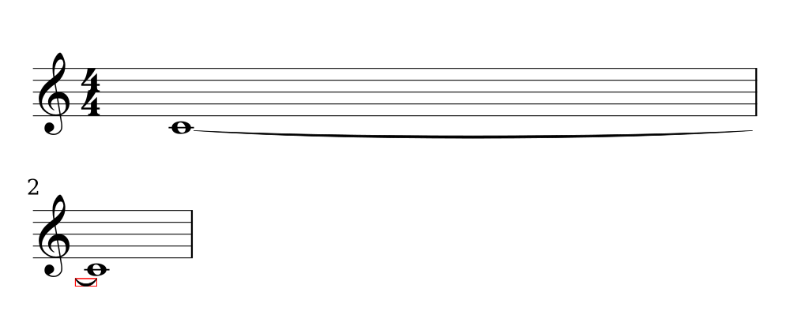
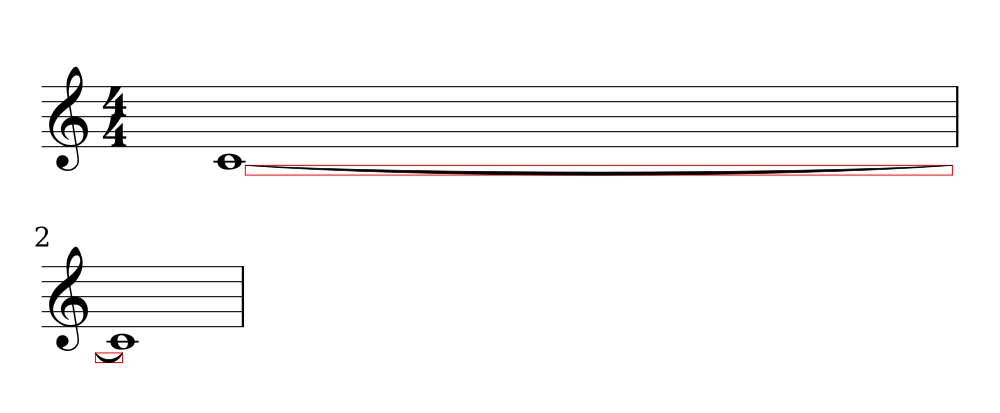
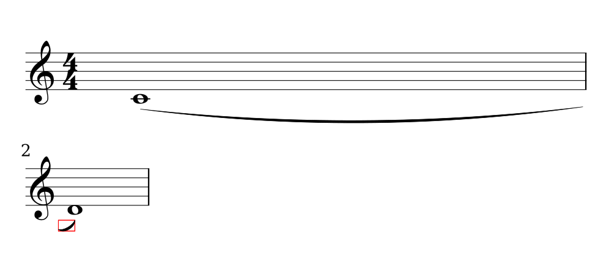
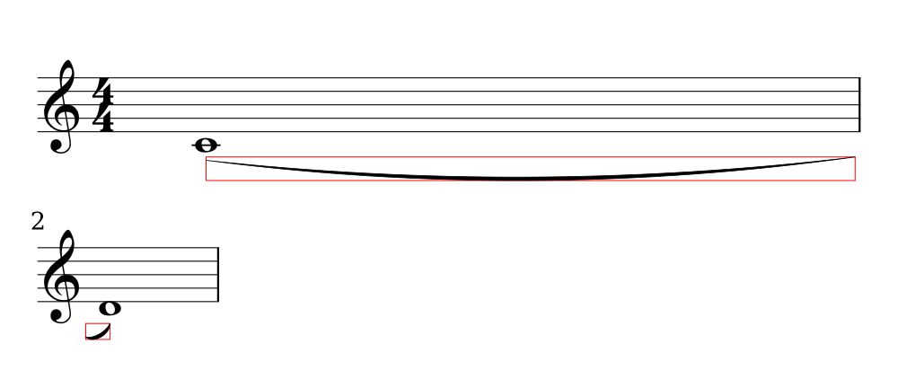
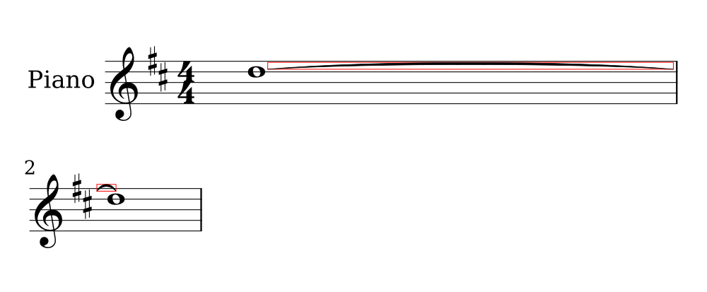

# Verovio #4562 — per-segment SVG bounding boxes

These fixtures, drivers and logs are review artifacts for the #4562 PR, kept outside the production patch per the repository instructions. The independently authored MEI fixtures and test drivers are available under LGPL-3.0-or-later, consistent with Verovio.

Base `bfbcec3c9a0c933aa832f779a5cc057285857d06`.
Fix `227d7dbbf6e6e0c47cdadc63be3010f15c949658`, independent branch `fix/4562-svg-span-bounds` (does not include #4533).
Production diff: one C++ file, 18 added / 2 removed lines. Reproduction artifacts remain separate from the production patch, as required by upstream AGENTS.

## Problem and fix

An empty first-segment placeholder is closed with the floating positioner left from the last system. The first segment is drawn later through ResumeGraphic, but EndResumedGraphic never refreshes its bounds. Continuations also reuse the same bbox IDs.

Refresh a resumed floating object's self/content box after its actual segment has drawn. Give continuation boxes a staff-specific suffix. Preserve the first box's conventional ID, normal SVG ink, and non-bounding-box mode. Match the existing `id-<object> spanning` class marker in both XML and HTML5 modes.

## Minimal reproduction

From a Verovio checkout, with this artifact directory downloaded as `/tmp/repro-4562`:

```sh
cmake -S cmake -B build/cli -DCMAKE_BUILD_TYPE=Debug
cmake --build build/cli --parallel 2
build/cli/verovio -r data --xml-id-seed 1 -t svg --breaks encoded --header none --footer none --page-width 1200 --adjust-page-height --svg-bounding-boxes -o /tmp/tie.svg /tmp/repro-4562/tie-split.mei
```

Execute on base and fix revisions, saving the outputs separately. On the base, both tie segments contain `bbox-span1` with the second segment's rectangle; the first path is outside its own box. On the fix, the first segment keeps `bbox-span1`, the continuation has a staff-suffixed ID, and each rectangle contains the corresponding path. `slur-split.mei` reproduces the same defect for slurs. Single-system variants are negative controls. `reporter.musicxml` preserves the original input from the issue, and `reporter-converted.mei` preserves the fixed CLI's MEI conversion; use the original MusicXML to exercise the importer.

Repeat with `--svg-content-bounding-boxes` added, and separately with `--svg-html5` added. Plain rendering without any bbox flags must stay unchanged. The four authored fixtures validate against the official MEI 5.1 CMN Relax NG schema. The reporter's MusicXML is retained verbatim; its license is not independently asserted here.

## Executed verification

- Linux ARM64 GCC 14 Debug, native full-feature CLI: 5 inputs × 4 modes = 20 checks pass. Base fails 9 bbox cases; plain and single-system controls pass. Checks cover a segment's path-start coordinate inside its own rectangle (2-unit rounding tolerance), self/content box ID uniqueness, and absence of boxes in plain mode.
- Actual C++ compiled to WebAssembly (Emscripten 3.1.69, Node 20.19.2, O1, no Humdrum): same 20 SVG geometry/ID checks pass. These are API calls against the freshly compiled module, not npm's published binary or a browser UI test.
- 69 official MEIs: normal SVG bytes identical; with bbox mode, all remaining notation XML elements/attributes/order identical after removing box groups and whitespace-only XML formatting. This is a targeted comparison under identical explicit options, not the full upstream regression runner. External input blob hashes are in the manifest.
- clang-format 22.1.8, diff check, 4 MEI schema checks pass.
- Visually inspected before/after tie, slur, and the reporter's MusicXML (CairoSVG PNG renderings). Transparent diagnostic rectangles are shown as red outlines on white backgrounds; those display-only changes are not in the product patch.

Original execution layout: native `/verovio-baseline` and `/verovio-4562-fixed`; resource `/verovio-src/data`; fixture root `/verovio-4562`; external corpus `/verovio-corpus`. Actual commands:

```sh
python3 /verovio-4562/check.py base /verovio-baseline
python3 /verovio-4562/check.py fixed /verovio-4562-fixed
python3 /verovio-4562/corpus-compare.py
node /verovio-4562/wasm-check.cjs
python3 /verovio-4562/validate-svg.py wasm unused
```

The baseline command intentionally fails. The first corpus comparison retained whitespace after removing box nodes and flagged formatting differences; after checking an XML diff, the comparator was corrected to ignore whitespace-only nodes. The normalized comparison passes all 69. An initial WASM file-discovery check also picked up the generated converted MEI; the case list was made explicit, and all 20 intended inputs/modes pass. Neither harness correction changed product code.

Native and WASM builds use independent snapshots of the #4562 code, with expansionmap.cpp restored to the base. Build/link/test outputs are saved under `validation/`.






